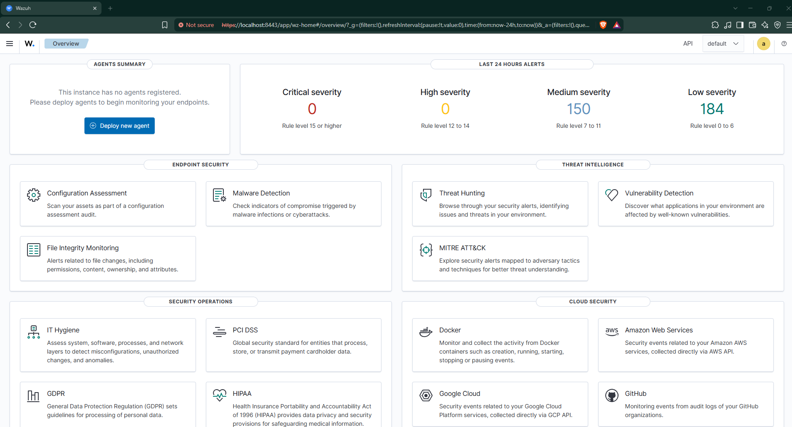
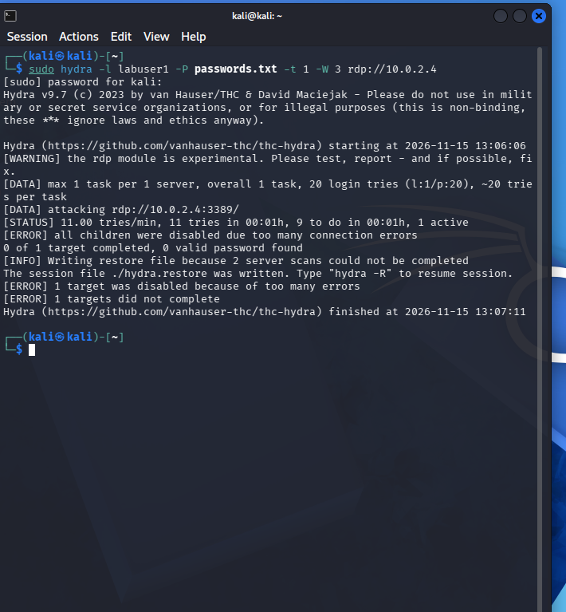
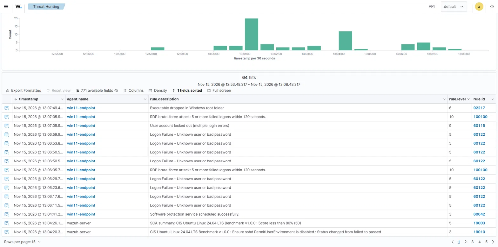
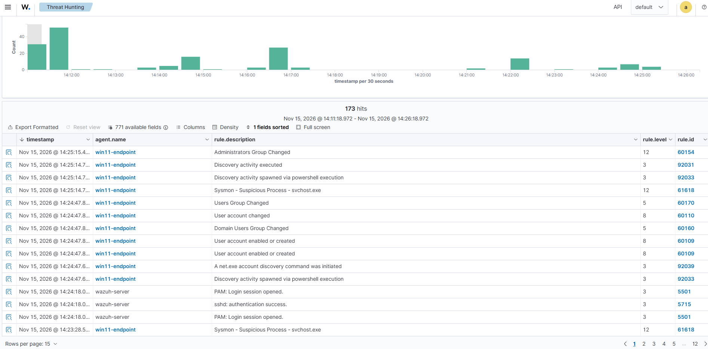
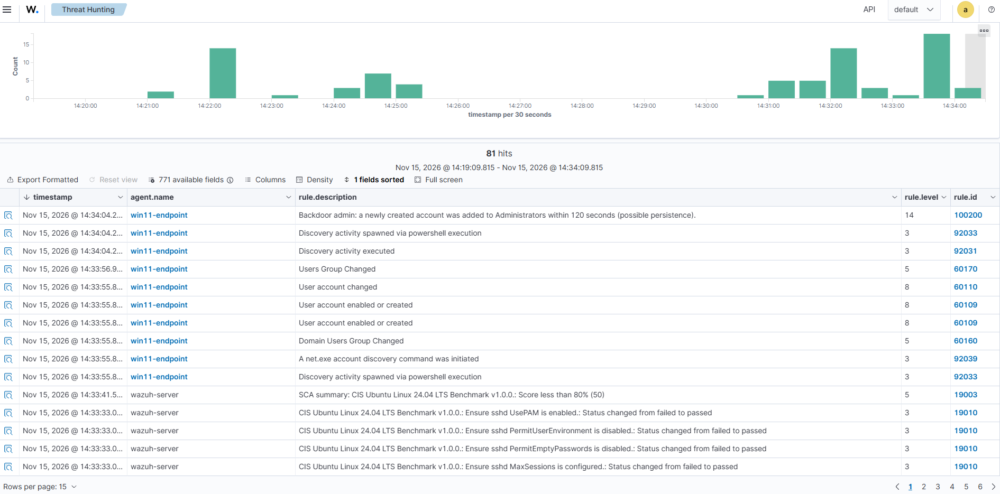
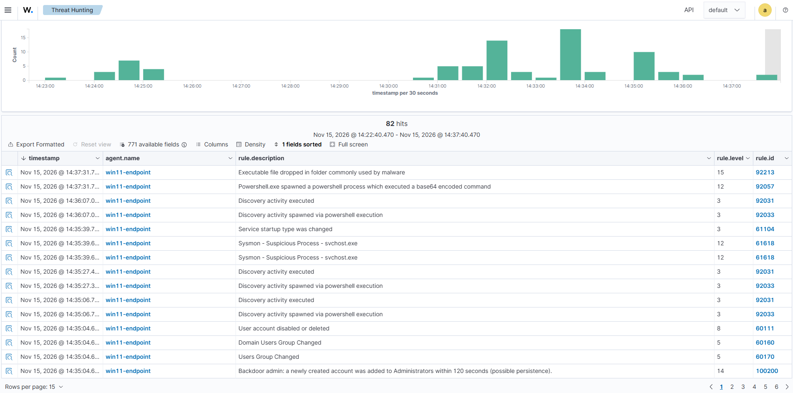

# SOC Detection Lab

A home SOC (Security Operations Center) built to practice detection engineering: deploy a SIEM, monitor a Windows endpoint, run real attacker techniques from Kali, and verify, tune, and write the detections that catch them.

> Status: in progress. This README is a living document and will grow as more techniques are added.

## Summary

I built a three-VM lab, stood up Wazuh as the SIEM, and instrumented a Windows 11 endpoint with Sysmon. I then ran four MITRE ATT&CK techniques against it and worked each one as a detection-engineering exercise: did Wazuh catch it out of the box, and if not, what custom rule closes the gap? The result is a mix — some techniques Wazuh detects cleanly, others needed custom rules — which is the point: knowing when to write a rule and when the coverage is already good.



## Lab architecture

All VMs run in VirtualBox on an isolated **NAT Network** (`SOC-Lab`). The lab network is sealed off from the host's home network; attack tools are only ever run from Kali (or locally on the endpoint to simulate post-compromise activity) against lab IPs (`10.0.2.0/24`).

| VM | Role | OS | IP | Resources |
|---|---|---|---|---|
| `wazuh-server` | SIEM (manager, indexer, dashboard) | Ubuntu Server 24.04.5 LTS | 10.0.2.3 | 8 GB RAM, 4 vCPU, 60 GB |
| `win11-endpoint` | Monitored victim endpoint | Windows 11 Enterprise (Eval) | 10.0.2.4 | 6 GB RAM, 2 vCPU, 64 GB |
| `kali` | Attacker | Kali Linux | 10.0.2.5 | 4 GB RAM, 2 vCPU |

**Telemetry pipeline:** Sysmon (SwiftOnSecurity config) + Windows Security logs -> Wazuh agent -> Wazuh manager -> rules engine -> dashboard alerts.

Software: Wazuh 4.14 (all-in-one), Wazuh agent 4.14.10, Sysmon v15.22.

The monitored endpoint reporting in as an active agent:


Sysmon events flowing into Wazuh (process creation, network, registry):


## Detections

### 1. Reconnaissance — port scan (T1046)

Ran an Nmap scan from Kali to confirm the attack surface:

```
nmap -p 3389 10.0.2.4
# 3389/tcp open  ms-wbt-server
```

### 2. Brute force — RDP (T1110)

**Attack (from Kali):**

```
sudo hydra -l labuser1 -P passwords.txt -t 1 -W 3 rdp://10.0.2.4
```



**Out-of-the-box detection:** Wazuh raised rule **60122 – "Logon Failure – Unknown user or bad password"** (level 5) for each failed logon on `win11-endpoint`.


**Gap found:** a slow attack (`-t 1`, spaced-out attempts) produced individual failure alerts but did **not** trigger a correlated, higher-severity brute-force alert. Detecting one failed login is low-signal; detecting a *burst* is what matters.

**Custom rule — frequency correlation (`rules/local_rules.xml`, rule 100100):**

```xml
<rule id="100100" level="10" frequency="5" timeframe="120">
  <if_matched_sid>60122</if_matched_sid>
  <description>RDP brute-force attack: 5 or more failed logons within 120 seconds.</description>
  <mitre><id>T1110</id></mitre>
</rule>
```

Correlates 5+ failed-logon events inside a 120-second window into a single level-10 alert. After reloading rules and re-running the attack, the custom alert **fired (verified)**.

**Bonus detection:** the attack also tripped built-in rule **60115 – "User account locked out (multiple login errors)"** (level 9). The full chain: failed logons (60122) -> correlated brute force (100100) -> account lockout (60115).



### 3. Rogue admin account — Create Account (T1136)

Simulating an attacker with a foothold creating a backdoor admin for persistence. Run on the endpoint:

```
net user eviladmin <password> /add
net localgroup Administrators eviladmin /add
```

**Out-of-the-box detection (excellent):** Wazuh flagged the whole sequence, including:
- **60109** (level 8) – "User account enabled or created"
- **60154** (level 12) – "Administrators Group Changed" (the account being granted admin)
- **92039** (level 3) – the `net.exe` account command itself

This technique needed **no custom rule** — the out-of-box coverage is strong, including a level-12 alert for the privileged group change. Recognizing when coverage is already good (and not adding redundant rules) is itself the goal.



**Optional enhancement — event correlation (`rules/local_rules.xml`, rule 100200):** to produce a single high-confidence "backdoor admin" alert, I chained two different events — a new account (60109) followed by an Administrators-group change (60154) within 120 seconds:

```xml
<rule id="100200" level="14" timeframe="120">
  <if_sid>60154</if_sid>
  <if_matched_sid>60109</if_matched_sid>
  <description>Backdoor admin: a newly created account was added to Administrators within 120 seconds (possible persistence).</description>
  <mitre><id>T1136</id><id>T1098</id></mitre>
</rule>
```

This fires at level 14 — higher than either individual alert — only when both events occur together, which is the unmistakable backdoor-admin signature.



### 4. Obfuscation — encoded PowerShell (T1059.001)

Attackers base64-encode PowerShell commands to hide what they run. Simulated on the endpoint:

```
powershell.exe -EncodedCommand <base64>
```

**Out-of-the-box detection:** Wazuh (via Sysmon process-creation telemetry) raised rule **92057** (level 12) – "Powershell.exe spawned a powershell process which executed a base64 encoded command." Caught cleanly, no custom rule needed.



## Results

| Technique | ATT&CK | Detection | Rule(s) | Notes |
|---|---|---|---|---|
| Port scan | T1046 | Logged | — | Recon; confirmed RDP exposed |
| RDP brute force | T1110 | **Custom (frequency)** | 100100 (lvl 10) | Out-of-box gave single failures (60122); correlation rule closes the gap |
| Account lockout | — | Out of the box (bonus) | 60115 (lvl 9) | Lockout from the brute force was logged |
| Rogue admin account | T1136 | Out of the box | 60154 (lvl 12) | Strong coverage; no rule required |
| Backdoor admin (correlated) | T1136 / T1098 | **Custom (correlation)** | 100200 (lvl 14) | Chains account-created + added-to-admins |
| Encoded PowerShell | T1059.001 | Out of the box | 92057 (lvl 12) | Sysmon command-line telemetry |

Two custom rules, two different styles — a **frequency** rule and an **event-correlation** rule — plus verified out-of-the-box coverage for the techniques that don't need tuning.

## Challenges and lessons learned

- **Ubuntu guest boot hang** at "Loading essential drivers": fixed by setting the VM boot order to Hard Disk first and switching the graphics controller to VMSVGA.
- **`wazuh-manager` and `wazuh-indexer` timed out on boot** (`start operation timed out`) because the heavy Java services don't finish starting within systemd's default timeout under VM resource contention — especially on the first boot after a shutdown, when the indexer recovers its data. Fixed both with systemd drop-in overrides raising `TimeoutStartSec` to 600s.
- **Agent showed "disconnected" / "no agents registered" after a reboot** because the manager came up while the indexer was still failing. Restarting the manager once the indexer was healthy re-synced the agent — service start order matters.
- **Keyboard remap (PowerToys) does not pass into VirtualBox,** and a dead physical P key made the Windows host painful. Worked around it by running commands from Kali, over SSH, and via the Windows On-Screen Keyboard.
- **Hydra's RDP module is experimental** and falsely reported a "valid password." Confirmed it was a false positive against the logs (Wazuh recorded a failed logon). A reminder to validate tool output against the authoritative source.
- **Installing the monitoring tools themselves generated alerts** (including a level-12 Sysmon alert) — the first lesson in false-positive triage: not every alert is an attack.

## Next steps

- Add more techniques: persistence via Run key / scheduled task (T1547 / T1053), credential dumping, lateral movement.
- Build a false-positive baseline by performing normal admin activity and confirming custom rules stay quiet.
- Map detections in Wazuh's MITRE ATT&CK view.
- Add the existing Metasploitable VM as a second (Linux) victim.

---

*Lab built for learning/portfolio purposes. All attacks were performed only against virtual machines I own, on an isolated network.*
