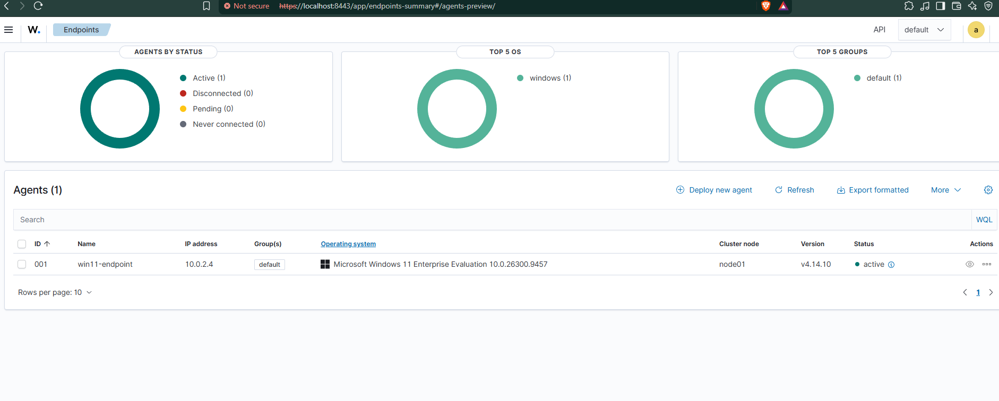
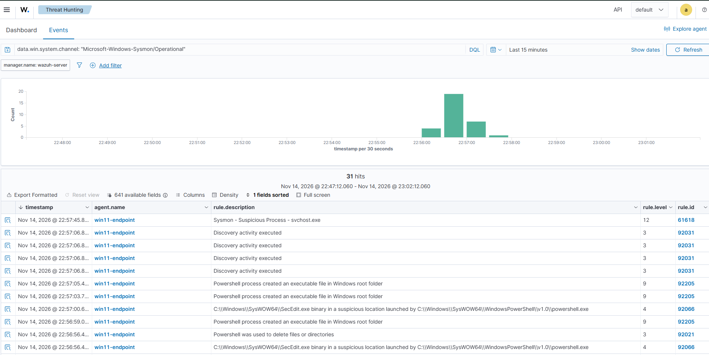
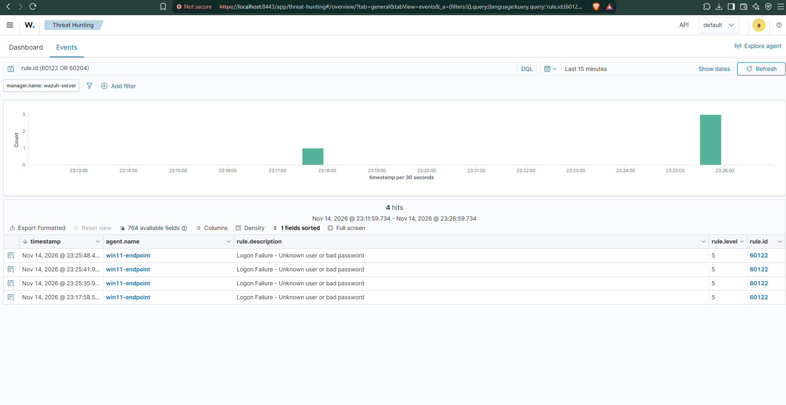

# SOC Detection Lab

A home SOC (Security Operations Center) built to practice detection engineering: deploy a SIEM, monitor a Windows endpoint, run real attacker techniques from Kali, and verify, tune, and write the detections that catch them.

> Status: in progress. This README is a living document and will grow as more techniques are added.

## Summary

I built a three-VM lab, stood up Wazuh as the SIEM, instrumented a Windows 11 endpoint with Sysmon, and used it to detect an RDP brute-force attack (MITRE ATT&CK T1110). Wazuh detected the individual failed logons out of the box but did **not** raise a correlated brute-force alert for a slow attack, so I wrote a custom rule to close that gap — then verified it fires on a live attack, alongside a bonus account-lockout detection.


## Lab architecture

All VMs run in VirtualBox on an isolated **NAT Network** (`SOC-Lab`). The lab network is sealed off from the host's home network; attack tools are only ever run from Kali against lab IPs (`10.0.2.0/24`).

| VM | Role | OS | IP | Resources |
|---|---|---|---|---|
| `wazuh-server` | SIEM (manager, indexer, dashboard) | Ubuntu Server 24.04.5 LTS | 10.0.2.3 | 8 GB RAM, 4 vCPU, 60 GB |
| `win11-endpoint` | Monitored victim endpoint | Windows 11 Enterprise (Eval) | 10.0.2.4 | 6 GB RAM, 2 vCPU, 64 GB |
| `kali` | Attacker | Kali Linux | 10.0.2.5 | 4 GB RAM, 2 vCPU |

**Telemetry pipeline:** Sysmon (SwiftOnSecurity config) + Windows Security logs -> Wazuh agent -> Wazuh manager -> rules engine -> dashboard alerts.

Software: Wazuh 4.14 (all-in-one), Wazuh agent 4.14.10, Sysmon v15.22.

The monitored endpoint reporting in as an active agent:



Sysmon events flowing into Wazuh (process creation, network, registry):



## Detections

### 1. Reconnaissance — port scan (T1046)

Ran an Nmap scan from Kali to confirm the attack surface:

```
nmap -p 3389 10.0.2.4
# 3389/tcp open  ms-wbt-server
```

### 2. Brute force — RDP (T1110)

**Attack (from Kali):**

```
sudo hydra -l labuser1 -P passwords.txt -t 1 -W 3 rdp://10.0.2.4
```


**Out-of-the-box detection:** Wazuh raised rule **60122 – "Logon Failure – Unknown user or bad password"** (level 5) for each failed logon on `win11-endpoint`.



**Gap found:** a slow attack (`-t 1`, spaced-out attempts) produced individual failure alerts but did **not** trigger a correlated, higher-severity brute-force alert. Detecting one failed login is low-signal; detecting a *burst* is what matters.

**Custom rule (`rules/local_rules.xml`):**

```xml
<group name="windows,authentication_failures,rdp,">
  <rule id="100100" level="10" frequency="5" timeframe="120">
    <if_matched_sid>60122</if_matched_sid>
    <description>RDP brute-force attack: 5 or more failed logons within 120 seconds.</description>
    <mitre>
      <id>T1110</id>
    </mitre>
    <group>authentication_failures,pci_dss_11.4,</group>
  </rule>
</group>
```

This correlates 5+ failed-logon events (rule 60122) inside a 120-second window into a single level-10 alert. After restarting the manager and re-running the attack, the custom alert **fired (verified)**.

**Bonus detection:** the attack also tripped Wazuh's built-in rule **60115 – "User account locked out (multiple login errors)"** (level 9). Windows auto-locked the account after repeated failures, and Wazuh logged it — showing the full chain: failed logons (60122) -> correlated brute force (100100) -> account lockout (60115).


## Results

| Technique | ATT&CK | Detection | Rule(s) | Notes |
|---|---|---|---|---|
| Port scan | T1046 | Logged | — | Recon step; confirmed RDP exposed |
| RDP brute force | T1110 | Out of the box (individual failures) | 60122 (level 5) | Single-failure alerts only |
| RDP brute force (correlated) | T1110 | **Custom rule** | 100100 (level 10) | Gap closed; verified firing |
| Account lockout | — | Out of the box (bonus) | 60115 (level 9) | Lockout from the attack was logged |

## Challenges and lessons learned

- **Ubuntu guest boot hang** at "Loading essential drivers": fixed by setting the VM boot order to Hard Disk first and switching the graphics controller to VMSVGA.
- **`wazuh-manager` and `wazuh-indexer` timed out on boot** (`start operation timed out`) because the heavy Java services don't finish starting within systemd's default timeout under VM resource contention — especially on the first boot after a shutdown, when the indexer recovers its data. Fixed both with systemd drop-in overrides raising `TimeoutStartSec` to 600s.
- **Agent showed "disconnected" then "no agents registered" after a reboot** because the manager came up while the indexer was still failing. Restarting the manager once the indexer was healthy re-synced the agent to Active — a reminder that service start order matters.
- **Keyboard remap (PowerToys) does not pass into VirtualBox,** and a dead physical P key made the Windows host painful. Worked around it by running commands from Kali (where the key worked) and over SSH, and using the Windows On-Screen Keyboard when needed.
- **Hydra's RDP module is experimental** and falsely reported a "valid password." Confirmed it was a false positive: Wazuh logged the attempt as a failed logon, not a success. A good reminder to validate tool output against the authoritative source (the logs).
- **Installing the monitoring tools themselves generated alerts** (including a level-12 Sysmon alert) — the first lesson in false-positive triage: not every alert is an attack.

## Next steps

- Add more techniques: new local admin account (T1136), persistence via Run key / scheduled task (T1547 / T1053), encoded PowerShell (T1059.001).
- Build a false-positive baseline by performing normal admin activity and confirming custom rules stay quiet.
- Map detections in Wazuh's MITRE ATT&CK view.
- Consider adding the existing Metasploitable VM as a second (Linux) victim.

---

*Lab built for learning/portfolio purposes. All attacks were performed only against virtual machines I own, on an isolated network.*
